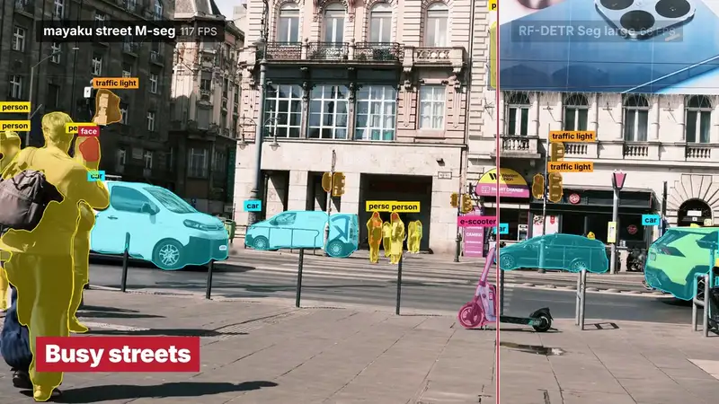
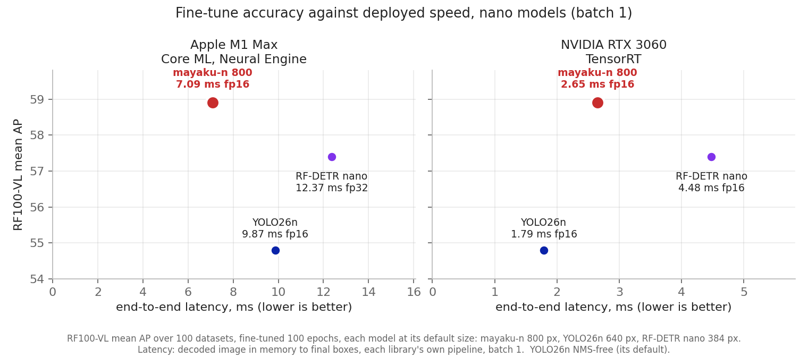
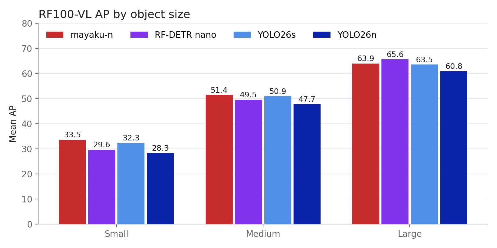

# Mayaku

[](https://github.com/emrahnazif/mayaku/actions/workflows/ci.yml)
[](https://pypi.org/project/mayaku/)
[](https://github.com/emrahnazif/mayaku/blob/main/LICENSE)

## Mayaku-Street


**The most accurate nano detector to fine-tune on your own data.** Mayaku is a real-time
detector family built for the job most people actually have: take a pretrained model, train
it on a few hundred images of your own objects, and ship it to whatever hardware you have.
For common jobs there are also ready-to-use models you run without training (see
[Ready-to-use models](#ready-to-use-models)).

Pure PyTorch, no custom CUDA kernels, Apache 2.0. One `pip install` trains on CUDA, Apple
Silicon or CPU, and every model exports to a graph of just five operations that runs on
any runtime, including true int8 on NPUs.



- **Highest fine-tune AP at nano size.** Across all 100 datasets of
  [RF100-VL](https://rf100-vl.org/), mayaku-n averages **58.9 AP**: ahead of RF-DETR nano
  (57.4, with 6× the parameters), YOLO26s (57.8) and YOLO26n (54.8).
- **True int8.** The deploy graph uses only convolutions, ReLU, add, max-pool and nearest
  resize, so it quantizes almost end to end: everything except the final output
  projections runs in int8. Quantization-aware training is on by default.
- **Runs and deploys everywhere.** No compiled extensions, no deformable convolutions, no
  attention. Parity-tested exports to ONNX, Core ML, OpenVINO and TensorRT.
- **Detection and instance segmentation** with one API and one training loop.

## Install

```bash
pip install mayaku
```

That is all. The runtime for an export target (onnxruntime, OpenVINO, Core ML, TensorRT) is
installed the first time you export to it or load one of its files, matched to your machine and
never replacing your torch.

## Quick start

Mayaku has two kinds of models. **Base models** (`mayaku-n-det`, `mayaku-m-seg`...) are
pretrained on Objects365 as a starting point for training on your data; they are not built to
be used as they are. **Ready-to-use models** (`mayaku-m-det-street`...) are finished models for
one kind of scene.

### Use a ready-to-use model

```python
from mayaku import from_pretrained

predictor = from_pretrained("mayaku-m-det-street")   # 22 road and street classes
det = predictor("crossing.jpg")
print(det.boxes, det.scores, det.labels)
```

### Fine-tune on your own data

Fine-tune on a COCO-format dataset. The pretrained weights download on first use, the
classifier resizes to your classes, and the schedule, canvas and class count are set from
your annotations.

```python
from mayaku import train, from_pretrained

result = train(
    weights="mayaku-n-det",                  # or "mayaku-n-seg" for masks
    train_annotations="data/train/_annotations.coco.json", train_images="data/train",
    val_annotations="data/valid/_annotations.coco.json", val_images="data/valid",
)

predictor = from_pretrained(result["final_weights"])
det = predictor("photo.jpg")                 # a path, a PIL image, or an OpenCV (BGR) frame
print(det.boxes, det.scores, det.labels)

predictor.export("onnx", "model.onnx")
```

The same from the command line:

```bash
mayaku train --weights mayaku-n-det \
  --annotations data/train/_annotations.coco.json --images data/train \
  --val-annotations data/valid/_annotations.coco.json --val-images data/valid
mayaku predict runs/mayaku-n-det/train/best.pt photo.jpg
mayaku export onnx runs/mayaku-n-det/train/best.pt --output model.onnx
```

## Ready-to-use models

Finished models for one kind of scene: download by name and predict. Each has its own page with
its classes, accuracy, speed and known limitations.

| Made for | Models | Details |
|---|---|---|
| Road and street scenes, dashcam to aerial, 22 classes | `mayaku-n-det-street`, `mayaku-n-seg-street`, `mayaku-m-det-street`, `mayaku-m-seg-street` | [Street models](https://emrah.fr/mayaku/ready-to-use/street/) |

### Street

People, faces, helmets, cars, trucks, buses, emergency vehicles, bicycles, e-scooters,
license plates, traffic lights, signs and more, from dashcam, CCTV, drone and straight-down
aerial views. On the 10 classes they share with COCO, against COCO-trained models at their
default input size (box AP@[.50:.95], car and truck merged):

| Model | Params | Street validation set | COCO val2017 | RTX 3060 fp16, network |
|---|---:|---:|---:|---:|
| **mayaku-m-det-street** | 32.4M | **65.3** | 57.1 | 5.36 ms |
| RF-DETR large | 33.9M | 56.3 | **61.8** | 5.42 ms |
| YOLO26l | 26.3M | 53.2 | 60.4 | 4.19 ms |
| **mayaku-n-det-street** | 5.2M | 52.2 | 51.2 | 1.49 ms |

Each model wins on its own ground: the street models on street scenes (17,712 images), the
COCO models on COCO's images and labels, which the street models never trained on. On drone and
aerial images the COCO models score 3 to 17 AP, the street medium 23 to 25. Over all 22 classes
the street medium scores 56.8 box AP and 45.5 mask AP, the nano 43.9 and 35.2.

## Fine-tuning benchmark: RF100-VL

RF100-VL is 100 real-world datasets (aerial, medical, industrial, documents, sports,
wildlife...), each with its own classes, mostly a few hundred to a few thousand images.
Every model is fine-tuned with its library's own defaults for 100 epochs, and every
checkpoint is scored by the same pycocotools evaluator on each dataset's validation split.

| Model | Params | Mean AP | AP<sub>S</sub> | AP<sub>M</sub> | AP<sub>L</sub> |
|---|---:|---:|---:|---:|---:|
| **mayaku-n** | **5.2M** | **58.9** | **33.3** | **52.2** | 64.1 |
| YOLO26s | 9.5M | 57.8 | 32.3 | 50.9 | 63.5 |
| RF-DETR nano | 30.5M | 57.4 | 29.6 | 49.5 | 65.6 |
| YOLO26n | 2.4M | 54.8 | 28.3 | 47.7 | 60.8 |

The gain is largest on small objects, where nano detectors usually struggle:



> **Protocol.** AP is COCO AP@[.50:.95] (pycocotools, `maxDets=100`) on each dataset's
> validation split, at the best epoch on that split, averaged over all 100 datasets.
> Parameters are deploy (fused) counts as published by each library. Every library trains
> at its own defaults.

## Deployment

### Five operations, nothing else

Every Mayaku model exports to a graph built from five operations: 1×1 and 3×3
convolutions (stride 1 or 2), ReLU, add, 3×3 max-pool and 2× nearest resize. No attention,
no depthwise or grouped convolutions, no concatenation, no transposed convolutions. The
export asserts it, so it can't drift. These are the operations every runtime and every
accelerator implements well, from TensorRT to mobile NPUs to microcontroller int8 kernels.

That one constraint is where the rest comes from:

- **Speed headroom.** Each layer is the fastest kind of layer on every chip, so the network
  is cheap per unit of compute.
- **Higher resolution at nano latency.** That headroom pays for an 800 px input, and
  resolution is what small objects need.
- **True int8, on any accelerator.** The graph quantizes almost end to end (below).
- **The whole graph on the NPU.** On Apple silicon every layer of the network runs on the
  Neural Engine (fp16); nothing falls back to the CPU or GPU halfway through.
- **One graph for every runtime.** The same file computes the same thing on TensorRT,
  Core ML, OpenVINO and ONNX Runtime; export checks it against PyTorch before returning.

### Latency

In the plot at the top, *end to end* is a decoded image in memory to final boxes in its
pixels, batch 1, with each library's own pre- and post-processing; each model at its
default input size.

### True int8

Because every layer is a plain convolution with ReLU, the network quantizes almost whole. On
TensorRT, Mayaku compiles to int8 everywhere except the final output projections.
Models train quantization-aware by default.

```bash
mayaku export tensorrt best.pt --precision int8 --output model.engine
```

### Images in

Pass a file path, a PIL image or a NumPy array in OpenCV's BGR order: camera and video
frames from `cv2.VideoCapture` go in as they are, with no conversion.

## Models

Which one to start from: if a [ready-to-use model](#ready-to-use-models) covers your objects and
cameras, use it as it is. If one comes close (your own classes, an unusual camera), fine-tune it.
Otherwise fine-tune a base model.

**Base models: fine-tune these on your data.** Pretrained on Objects365; detection and
segmentation train from COCO JSON.

| Name | Task | Params | GMACs (640) | Status |
|---|---|---:|---:|---|
| `mayaku-n-det` | detection | 5.2M | 6.7 | released |
| `mayaku-n-seg` | detection + instance masks | 5.3M | 7.1 | released |
| `mayaku-m-det` | detection | 32.4M | 46.3 | released |
| `mayaku-m-seg` | detection + instance masks | 32.7M | 47.3 | released |

`mayaku download --list` shows what is hosted.

## Documentation

The documentation is at [emrah.fr/mayaku](https://emrah.fr/mayaku/). The same pages come with the
package, matching the installed version, so a coding agent can read them offline. `llms.txt` in
that folder lists every page. This command prints the folder:

```bash
python -c "import mayaku, os; print(os.path.dirname(mayaku.__file__) + '/docs')"
```

## License

Apache 2.0, for the library and the published weights. See
[`LICENSE`](https://github.com/emrahnazif/mayaku/blob/main/LICENSE).
