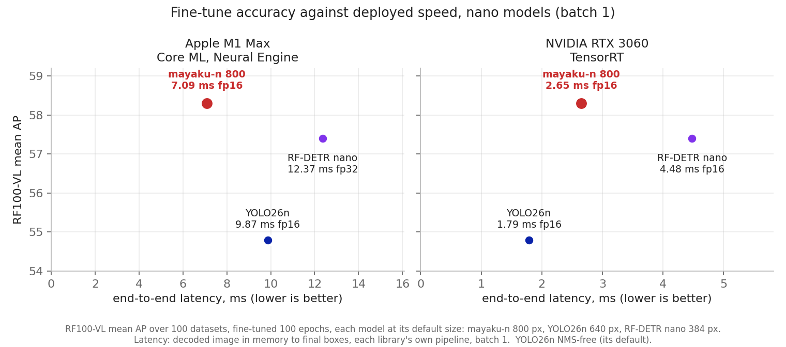
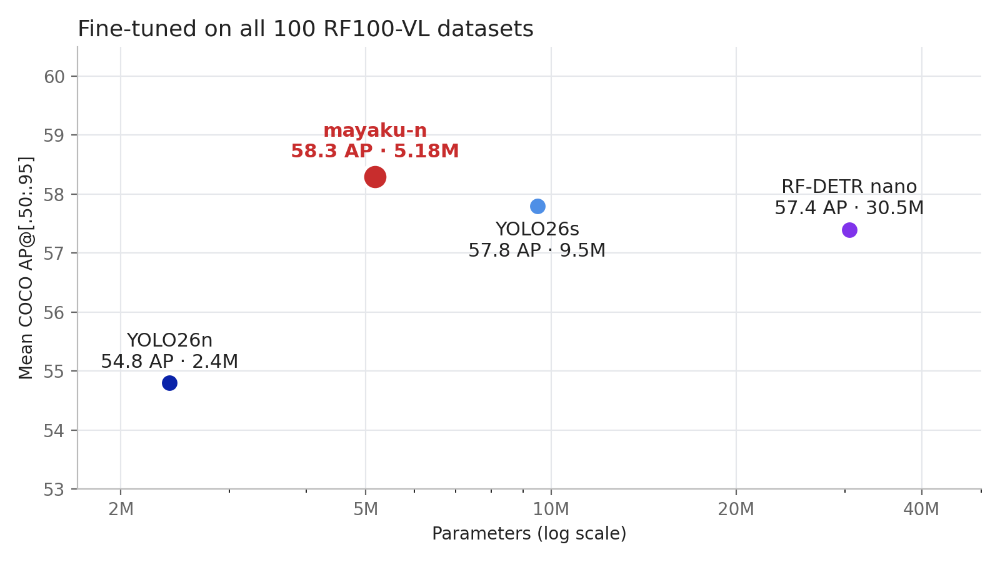
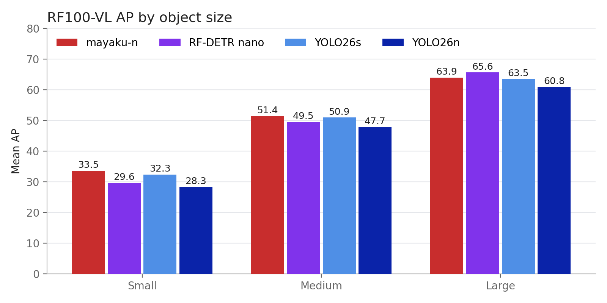

**The most accurate nano detector to fine-tune on your own data.** Mayaku is a real-time detector family built for the job most people actually have: take a pretrained model, train it on a few hundred images of your own objects, and ship it to whatever hardware you have.

Pure PyTorch, no custom CUDA kernels, Apache 2.0. One `pip install` trains on NVIDIA GPUs (CUDA), Apple Silicon (MPS) or the CPU, and every model exports to a graph of just five operations that runs on any runtime, including true int8 on NPUs.



*End to end* is a decoded image in memory to final boxes in its pixels, batch 1, with each library's own pre- and post-processing; each model at its default input size.

- **Highest fine-tune AP at nano size.** Across all 100 datasets of [RF100-VL](https://rf100-vl.org/), mayaku-n averages **58.3 AP**: ahead of RF-DETR nano (57.4, with 6× the parameters), YOLO26s (57.8) and YOLO26n (54.8).
- **True int8.** The deploy graph quantizes almost end to end: everything except the final output projections runs in int8. Quantization-aware training is on by default.
- **Runs and deploys everywhere.** No compiled extensions, no deformable convolutions, no attention. Parity-tested exports to ONNX, Core ML, OpenVINO and TensorRT, whose runtimes install themselves when first needed.
- **Detection and instance segmentation** with one API and one training loop.

## Minimal example

```bash
pip install mayaku
```

```python
from mayaku import train, from_pretrained

result = train(
    weights="mayaku-n-det",                  # or "mayaku-n-seg" for masks
    train_annotations="data/train/_annotations.coco.json", train_images="data/train",
    val_annotations="data/valid/_annotations.coco.json", val_images="data/valid",
)

predictor = from_pretrained(result["final_weights"])
det = predictor("photo.jpg")                 # a path, a PIL image, or an OpenCV (BGR) frame
print(det.boxes, det.scores, det.labels)

predictor.export("onnx", "model.onnx")
```

The pretrained weights download on first use, the classifier resizes to your classes, and the schedule, canvas and class count are set from your annotations.

## Five operations, nothing else

Every Mayaku model exports to a graph built from five operations: 1×1 and 3×3 convolutions (stride 1 or 2), ReLU, add, 3×3 max-pool and 2× nearest resize. No attention, no depthwise or grouped convolutions, no concatenation, no transposed convolutions. The export asserts it, so it can't drift. That one constraint is where the rest comes from:

- **Speed headroom.** Each layer is the fastest kind of layer on every chip, so the network is cheap per unit of compute.
- **Higher resolution at nano latency.** That headroom pays for an 800 px input, and resolution is what small objects need.
- **True int8, on any accelerator.** The graph quantizes almost end to end: everything except the final output projections runs in int8.
- **The whole graph on the NPU.** On Apple silicon every layer of the network runs on the Neural Engine (fp16); nothing falls back to the CPU or GPU halfway through.
- **One graph for every runtime.** The same file computes the same thing on TensorRT, Core ML, OpenVINO and ONNX Runtime; export checks it against PyTorch before returning.

## Fine-tuning benchmark: RF100-VL

RF100-VL is 100 real-world datasets (aerial, medical, industrial, documents, sports, wildlife...), each with its own classes, mostly a few hundred to a few thousand images. Every model is fine-tuned with its library's own defaults for 100 epochs and scored by the same pycocotools evaluator on each dataset's validation split.

| Model | Params | Mean AP | AP<sub>S</sub> | AP<sub>M</sub> | AP<sub>L</sub> |
|---|---:|---:|---:|---:|---:|
| **mayaku-n** | **5.2M** | **58.3** | **33.5** | **51.4** | 63.9 |
| YOLO26s | 9.5M | 57.8 | 32.3 | 50.9 | 63.5 |
| RF-DETR nano | 30.5M | 57.4 | 29.6 | 49.5 | 65.6 |
| YOLO26n | 2.4M | 54.8 | 28.3 | 47.7 | 60.8 |





> **Protocol.** AP is COCO AP@[.50:.95] (pycocotools, `maxDets=100`) on each dataset's validation split, at the best epoch on that split, averaged over all 100 datasets. Parameters are deploy (fused) counts as published by each library. Every library trains at its own defaults.

## Models

| Name | Task | Params | GMACs (640) | Status |
|---|---|---:|---:|---|
| `mayaku-n-det` | detection | 5.2M | 6.7 | released |
| `mayaku-n-seg` | detection + instance masks | 5.3M | 7.1 | released |
| `mayaku-m-det` | detection | 32.4M | 46.3 | finishing training |
| `mayaku-m-seg` | detection + instance masks | 32.7M | 47.3 | finishing training |

All are pretrained on Objects365 and fine-tune from COCO JSON. Pass a name and Mayaku downloads the weights the first time.

## Pages

First steps:

- [Installation](/mayaku/installation/): `pip install`, self-installing export runtimes, supported platforms.
- [Quickstart](/mayaku/quickstart/): train, predict, evaluate and export a detector in five commands.

Data and training:

- [Datasets](/mayaku/data-and-training/datasets/): the COCO JSON layout detection and segmentation need.
- [Models](/mayaku/data-and-training/models/): the hosted model names, the sizes, and how weights are downloaded.
- [Training](/mayaku/data-and-training/training/): `mayaku.train`, the run directory, auto-config, resuming, multiple GPUs.

Deployment:

- [Evaluation](/mayaku/deployment/evaluation/): COCO metrics, and what each metric key means.
- [Export](/mayaku/deployment/export/): ONNX, Core ML, OpenVINO, TensorRT, precisions and int8.
- [Prediction](/mayaku/deployment/prediction/): `from_pretrained`, the `Detections` object, batches, the JSON output of `mayaku predict`.

More tasks:

- [Instance segmentation](/mayaku/more-tasks/segmentation/)
- Experimental, in the library but not yet benchmarked: [image classification](/mayaku/more-tasks/classification/), [keypoint detection](/mayaku/more-tasks/keypoints/), [oriented boxes](/mayaku/more-tasks/oriented-boxes/).

Reference:

- [Command line](/mayaku/reference/cli/): every `mayaku` command and option.
- [Configuration](/mayaku/reference/configuration/): every config field, its default, and how to set it.
- [Python API](/mayaku/reference/python-api/): every public function and class.
- [Troubleshooting](/mayaku/reference/troubleshooting/): error messages and what to do about them.

## Key facts

- Package: `mayaku` on PyPI. Python 3.10, 3.11 or 3.12. Linux and macOS.
- License: Apache 2.0 for the library and every published model weight.
- Public Python entry points: `mayaku.train`, `mayaku.evaluate`, `mayaku.from_pretrained`, `mayaku.health_check`.
- Command line: `mayaku train`, `mayaku eval`, `mayaku predict`, `mayaku export`, `mayaku download`.
- Every checkpoint and every exported file carries its own configuration and class names. You never need a separate config file to run a trained model.
- Source: <https://github.com/emrahnazif/mayaku>
