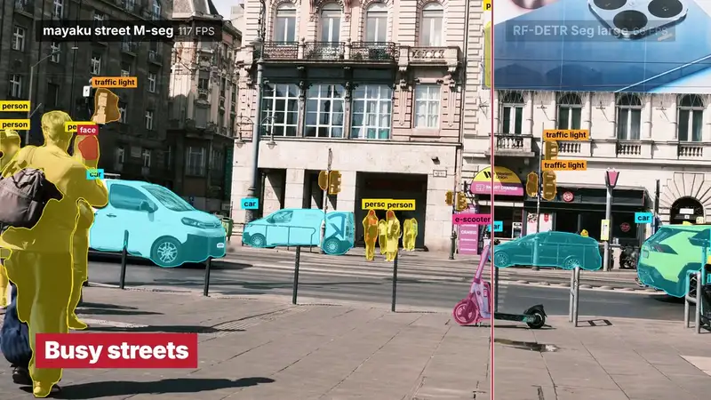

# {{name}}



**Detect people, vehicles, e-scooters, faces and license plates in road scenes, from dashcam to
drone, with a model you use as it is.** No data and no training needed.

`{{name}}` is the **{{tier_word}}** street model and gives **{{gives}}**: {{tier_pitch}}
It is one of four [Mayaku](https://github.com/emrahnazif/mayaku) street models:

{{family_table}}

AP is COCO AP@[.50:.95] on the street validation set (below). Times are end to end on one RTX
3060: a 1920×1080 frame in memory to final boxes (and masks pasted at frame size) in host memory,
TensorRT through Mayaku's own export, batch 1, median of 1,000 frames. Take a `-seg` model only
when you need the masks: most of its time goes into pasting the masks into the full frame on the
CPU.

## Use it

```bash
pip install mayaku
```

```python
from mayaku import from_pretrained

predictor = from_pretrained("{{name}}")   # downloads on first use
det = predictor("crossing.jpg")           # a path, a PIL image, or an OpenCV (BGR) frame
for box, score, label in zip(det.boxes, det.scores, det.labels):
    print(predictor.class_names[label], round(float(score), 2), box.tolist())
```

Or take the weights from this page:

```python
from huggingface_hub import snapshot_download
from mayaku import from_pretrained

folder = snapshot_download("enazif/{{name}}")
predictor = from_pretrained(f"{folder}/{{name}}.pth")
```

From the command line:

```bash
mayaku predict {{name}} crossing.jpg
```

It exports to ONNX, TensorRT, OpenVINO and Core ML, int8 included, as a graph of five plain
operations that runs on any runtime and NPU:

```python
predictor.export("onnx", precision="int8")
```

See [Export](https://emrah.fr/mayaku/deployment/export/).

## Run with OpenVINO

The `openvino/` folder holds this model as OpenVINO IR, in fp16 and int8. Measured on an Intel
CPU, int8 is the fast choice: {{openvino_speed}} per 1920×1080 frame
end to end on an i9-10900X (median of 60 frames), and on 1,500 street validation images its box
AP is within 0.3 of fp32.

```python
from huggingface_hub import snapshot_download
from mayaku import from_pretrained

folder = snapshot_download("enazif/{{name}}", allow_patterns="openvino/*")
predictor = from_pretrained(f"{folder}/openvino/{{name}}-int8.xml")
det = predictor("crossing.jpg")
```

The class names and decode settings are embedded in each file. They were written by
`predictor.export("openvino", precision="int8")`, which works the same on a model you fine-tuned.

## Run with Core ML

The `coreml/` folder holds this model as a Core ML package in fp16, which runs on the Apple
Neural Engine: {{coreml_speed}} per 1920×1080 frame end to end on an M1 Max (median of 60
frames). It needs macOS 13 / iOS 16 or newer.

```python
from huggingface_hub import snapshot_download
from mayaku import from_pretrained

folder = snapshot_download("enazif/{{name}}", allow_patterns="coreml/*")
predictor = from_pretrained(f"{folder}/coreml/{{name}}-fp16.mlpackage")
det = predictor("crossing.jpg")
```

A `.mlpackage` is a folder: copy it whole. The model outputs the network's raw maps; Mayaku's
predictor turns them into {{gives}}, so in Swift you decode them yourself. The class
names and decode settings are embedded in the package, written by `predictor.export("coreml")`.

## The 22 classes

| Group | Classes |
|---|---|
| People | person, face, helmet |
| Micromobility and assistive | bicycle, e-scooter, motorcycle, wheelchair, stroller |
| Vehicles | car, truck, bus, emergency vehicle, train, three-wheeler, construction vehicle, trailer |
| Road objects | license plate, traffic light, safety sign, stop sign, traffic cone |
| Other | animal |

Some classes are broader or narrower than in COCO:

- **car** is every light vehicle, vans, SUVs and pickups included. **truck** is heavy goods vehicles only.
- **emergency vehicle** is police cars, ambulances and fire engines.
- **e-scooter** is stand-up scooters. Seated scooters and mopeds are **motorcycle**.
- **train** includes trams. **three-wheeler** is tricycles, rickshaws and tuk-tuks. **construction vehicle** is excavators and forklifts.
- **safety sign** is regulatory and warning signs. Street-name, direction and shop signs are not detected. **stop sign** is its own class.
- **helmet** is any helmet, worn or not. **animal** is one class for dogs, cats, horses, cattle, sheep, birds and deer.

**face** and **license plate** are there so you can blur them before you store or share footage.

## Accuracy

On the street validation set: 17,712 images from Objects365, COCO, Wikimedia Commons, drone and
aerial sources, 22 classes, COCO AP@[.50:.95].

| | Box AP | AP50 | AP small | AP large | Mask AP |
|---|---:|---:|---:|---:|---:|
| street nano | 43.9 | 60.0 | 23.7 | 62.8 | 35.2 |
| street medium | 56.8 | 72.1 | 34.3 | 73.2 | 45.5 |

The `-det` and `-seg` models of one size give the same boxes; the mask AP is the `-seg` model's.

Strongest classes (medium, box AP): bus 78.6, train 75.1, car 72.3, person 66.1, face 65.7,
e-scooter 65.2, emergency vehicle 64.2, license plate 64.1. Weakest: trailer 24.5, stroller 26.9,
wheelchair 32.5 and construction vehicle 39.7, the classes with the fewest training examples.

### Compared with COCO models

On the 10 classes both have (person, bicycle, motorcycle, car, truck, bus, train, traffic light,
stop sign, animal), with car and truck merged into one vehicle class because COCO calls pickups
trucks and the street models call them cars. Each model at its library's default input size,
box AP@[.50:.95]:

| Model | Params | Street validation set | COCO val2017 | Network time, RTX 3060 fp16 |
|---|---:|---:|---:|---:|
| **street medium** | 32.4 M | **65.3** | 57.1 | 5.36 ms |
| RF-DETR large | 33.9 M | 56.3 | **61.8** | 5.42 ms |
| YOLO26l | 26.3 M | 53.2 | 60.4 | 4.19 ms |
| **street nano** | 5.2 M | 52.2 | 51.2 | 1.49 ms |
| YOLO26n | 2.6 M | 34.1 | 48.6 | |

On street scenes, street medium leads RF-DETR large by 9 AP and wins every shared class, and street
nano, at a fifth of its parameters, is within 1 AP of YOLO26l. On COCO's own images and labels the
COCO models lead: the street models never saw a COCO label. The clearest difference is from above:
on drone and aerial images, YOLO26l scores 3 to 9 AP and RF-DETR large 6 to 17, where street medium
scores 23 to 25.

COCO models ran with their published COCO weights at their default input size (YOLO26 640, RF-DETR
large 704), street models at 800. On the street set, objects of classes COCO has no name for are
ignored for COCO models, so missing them costs nothing. Each side is favoured by its own labelling
style, and the COCO models had seen the COCO and Objects365 images of the street set during their
training. Network time is the engine alone; the end-to-end times are in the table at the top.

## Prediction settings

Input is letterboxed to {{width}}×{{height}}. The model predicts at score {{conf}} with NMS at IoU {{iou}}.
[Prediction](https://emrah.fr/mayaku/deployment/prediction/) shows what a lower or higher
threshold trades and what to use with a tracker.

## Fine-tune on your own street data

When the model is close but not quite right (your own classes, an unusual camera position, more
accuracy on your scenes), fine-tune it: it already knows road scenes.

```python
from mayaku import train

result = train(
    weights="{{name}}",
    train_annotations="data/train/_annotations.coco.json", train_images="data/train",
    val_annotations="data/valid/_annotations.coco.json", val_images="data/valid",
)
```

With the same 22 classes in the same order, the model keeps everything it learned. With a
different number of classes, the class layer starts fresh and the rest of the network is kept.

## Known limitations

- **Faces without a person.** Faces on posters, statues and dolls are detected as faces.
- **Truck and car** are the most confused pair: the line between a large van or pickup (car) and a truck is not sharp.
- **Tiny people on drone images**, under about 8 pixels, cause most person false positives from above.
- **Crowds.** NMS removes some overlapping objects of the same class, such as people side by side.
- **Emergency vehicles** are under-counted in the validation labels, so their AP and precision are lower than what you see in use.

## Training data and credits

The training images are from Objects365, COCO, Wikimedia Commons (under their individual free
licences), the Songdo Vision dataset (Fonod, Cho, Yeo and Geroliminis, 2025), roundabout aerial
images by De-Las-Heras, Sánchez-Soriano and Puertas, and aerial photos from Beeldmateriaal
Nederland / PDOK. The labels were made with SAM 3. The weights are Apache 2.0, like the library.

## Links

- Library: [github.com/emrahnazif/mayaku](https://github.com/emrahnazif/mayaku), `pip install mayaku`
- Documentation: [emrah.fr/mayaku](https://emrah.fr/mayaku/), [Street models](https://emrah.fr/mayaku/ready-to-use/street/)
